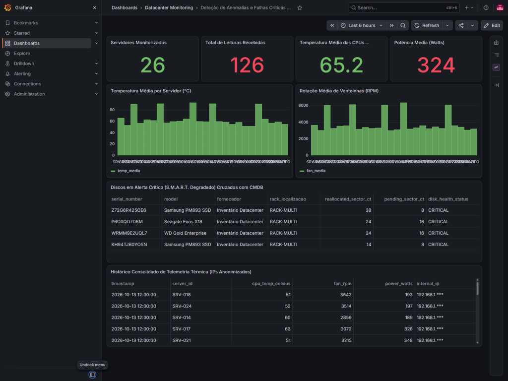

<div align="center">

<sub>Project for the Escola Superior de Tecnologia, Universidade Politécnica do Cávado e do Ave</sub>

# Datacenter Telemetry & Hardware Health ETL

**End-to-end ETL pipeline and real-time observability for datacenter hardware health and thermal telemetry.**

[](https://www.knime.com/)
[](https://www.postgresql.org/)
[](https://grafana.com/)
[](https://nodered.org/)
[](https://www.docker.com/)
<br/>
[](https://github.com/Julianagp24/datacenter-telemetry-etl)
[](LICENSE)

</div>

---

## Dashboard Preview



---

## Key Features

- **Multi-Format ETL Pipeline (KNIME):** Extracts and normalizes data from CSV (`telemetria_smart.csv`), JSON (`sensores_temperatura.json`), and hierarchical XML (`inventario_datacenter.xml`) using XPath and regex rules.
- **Data Quality & Anonymization:** Validates hardware identifiers (server IDs, MAC addresses, serial numbers, rack locations), filters spurious thermal readings outside `0°C - 120°C`, and masks server IP addresses (`192.168.1.***`).
- **Predictive Disk Failure & RMA Matching:** Correlates S.M.A.R.T. disk metrics (`reallocated_sector_ct`, `pending_sector_ct`) with CMDB server inventory to flag critical drives and calculate warranty/RMA eligibility.
- **Relational Persistence (PostgreSQL 16):** Automatically provisions normalized tables (`hardware_telemetry_history`, `hardware_critical_alerts`, `datacenter_inventory`) with indexes via `init.sql`.
- **Telemetry Simulation API (Node-RED):** Simulates IPMI sensor telemetry and exposes a REST endpoint (`/api/sensores/temperatura`).
- **Auto-Provisioned Observability (Grafana):** Pre-configured PostgreSQL data source and dashboard tracking CPU temperature/power averages, thermal spikes (`> 85°C`), and critical disk alerts.
- **Containerized Stack:** Single-command deployment with Docker Compose for PostgreSQL, Grafana, and Node-RED.

---

## Project Architecture

```text
datacenter-telemetry-etl/
├── README.md
│
├── assets/
│   └── grafana-dashboard.png              # Grafana observability dashboard preview
│
├── dataintegration/
│   └── datacenter_etl.knwf                # Exported KNIME Analytics ETL workflow
│
├── data/
│   ├── input/                             # Heterogeneous raw data sources
│   │   ├── telemetria_smart.csv           # Disk S.M.A.R.T. telemetry (CSV)
│   │   ├── sensores_temperatura.json      # Thermal & power sensor readings (JSON)
│   │   └── inventario_datacenter.xml      # Server catalog & CMDB metadata (XML)
│   │
│   └── output/                            # Processed ETL outputs
│       ├── ordens_substituicao_rma.csv    # Failing drives with warranty/RMA status
│       └── resumo_alertas*.json           # Generated sensor alert summaries (0–125)
│
└── src/
    ├── docker/                            # Container orchestration & DB schema
    │   ├── docker-compose.yml             # PostgreSQL 16, Grafana, and Node-RED
    │   ├── init.sql                       # Relational DDL schema & indexes
    │   └── grafana/                       # Auto-provisioned data source & dashboard
    │       ├── provisioning/
    │       │   ├── dashboards/dashboards.yml
    │       │   └── datasources/datasource.yml
    │       └── dashboards/datacenter_health.json
    └── nodered/                           # Node-RED runtime & flow configuration
        └── flows.json                     # IPMI simulation & HTTP REST endpoint
```

---

## Services & Endpoints

| Service | Purpose | URL / Port | Credentials / Details |
| :--- | :--- | :--- | :--- |
| **PostgreSQL 16** | Telemetry & alerts storage | `localhost:5432` | DB: `dc_datacenter` · User: `dc_user` · Pass: `dc_password` |
| **Grafana** | Real-time monitoring dashboard | `http://localhost:3000` | User: `admin` · Pass: `admin` |
| **Node-RED** | Sensor simulator & REST API | `http://localhost:1880` | Endpoint: `GET /api/sensores/temperatura` |

---

## Getting Started

### Prerequisites
- [Docker & Docker Compose](https://www.docker.com/)
- [KNIME Analytics Platform (v5.x)](https://www.knime.com/)

### 1. Clone & Start Infrastructure
```bash
git clone https://github.com/Julianagp24/datacenter-telemetry-etl.git
cd datacenter-telemetry-etl/src/docker
docker compose up -d
```
PostgreSQL will automatically initialize the schema from `init.sql`, and Grafana will auto-load the PostgreSQL data source and dashboard.

### 2. Run the ETL Pipeline in KNIME
1. Open **KNIME Analytics Platform**.
2. Go to **File > Import KNIME Workflow...** and select `dataintegration/datacenter_etl.knwf`.
3. Verify the reader nodes point to `data/input/` and the `DB Connector` uses `dc_datacenter` / `dc_user` / `dc_password`.
4. Execute the full workflow (**Shift + F7**) to generate outputs in `data/output/` and populate PostgreSQL.

### 3. View Metrics in Grafana
1. Open **`http://localhost:3000`** (`admin` / `admin`).
2. Navigate to **Dashboards > Datacenter Monitoring > Deteção de Anomalias e Falhas Críticas de Hardware**.

---

## License
This project is licensed under the MIT License.
